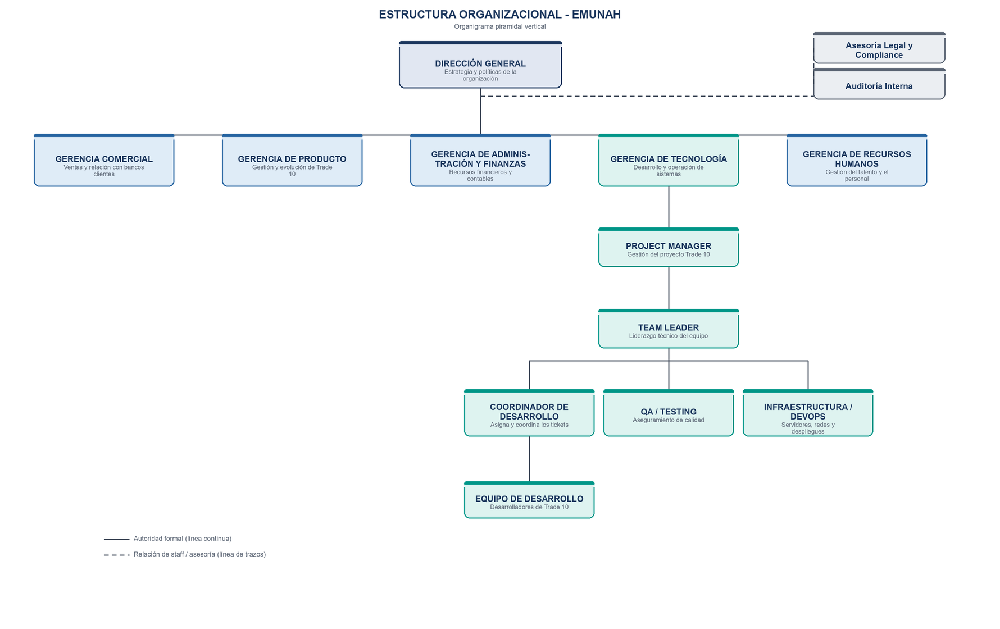

# Entrega 3 · Estructura formal y diseño de datos

> Síntesis de la Entrega 3 del TPI.

## Organigrama piramidal vertical

- **Dirección General** en la cúspide, con dos áreas de **staff** (líneas de trazos): Asesoría Legal y Compliance, y Auditoría Interna.
- **Gerencias funcionales**: Comercial, Producto, Administración y Finanzas, Tecnología y Recursos Humanos.
- **Gerencia de Tecnología** → Project Manager → Team Leader → Coordinador de Desarrollo, QA / Testing e Infraestructura / DevOps → Equipo de Desarrollo.

Los roles de esta estructura son los mismos que aparecen como *lanes* en el [modelo BPMN](04-proceso-bpmn.md).

## Diccionario de datos inicial

### Desarrollador
Integrante del equipo de desarrollo cuyo trabajo registra y analiza el módulo.

| Campo | Tipo | Descripción |
|---|---|---|
| `id_desarrollador` | Integer | Identificador único del desarrollador dentro del sistema. |
| `nombre_completo` | String | Nombre y apellido del desarrollador. |
| `email` | String | Correo electrónico corporativo, usado para identificarlo y notificarlo. |
| `seniority` | String | Nivel de experiencia (por ejemplo: Junior, Semi Senior, Senior). |
| `disponible` | Boolean | Indica si el desarrollador está disponible para recibir nuevos tickets. |
| `activo` | Boolean | Indica si el desarrollador se encuentra actualmente en el equipo. |

### Ticket
Requerimiento, incidente o tarea que ingresa por Jira y se asigna al equipo.

| Campo | Tipo | Descripción |
|---|---|---|
| `id_ticket` | Integer | Identificador único del ticket. |
| `titulo` | String | Título o resumen del requerimiento a resolver. |
| `modulo_afectado` | String | Módulo, pantalla o componente de Trade 10 afectado por el ticket. |
| `tipo` | String | Clasificación del ticket (incidente, mejora, nueva funcionalidad). |
| `estado` | String | Estado del ticket en el tablero (Por Hacer, En Progreso, Listo). |
| `id_desarrollador` | Integer | Desarrollador responsable al que se asignó el ticket (relación con Desarrollador). |

### RegistroDeHoras
Propuesta de horas trabajadas que genera el módulo y que el desarrollador confirma (Meta 1).

| Campo | Tipo | Descripción |
|---|---|---|
| `id_registro` | Integer | Identificador único del registro de horas. |
| `id_desarrollador` | Integer | Desarrollador que realizó el trabajo (relación con Desarrollador). |
| `id_ticket` | Integer | Ticket sobre el que se trabajó (relación con Ticket). |
| `fecha` | Date | Día al que corresponde el trabajo registrado. |
| `horas_propuestas` | Float | Cantidad de horas estimada automáticamente por el módulo. |
| `confirmado` | Boolean | Indica si el desarrollador validó la propuesta de horas. |

### PerfilTecnico
Conocimiento acumulado por cada desarrollador, usado para sugerir asignaciones (Meta 3).

| Campo | Tipo | Descripción |
|---|---|---|
| `id_perfil` | Integer | Identificador único del registro de perfil técnico. |
| `id_desarrollador` | Integer | Desarrollador al que pertenece el perfil (relación con Desarrollador). |
| `tecnologia` | String | Tecnología o módulo de Trade 10 en el que tiene experiencia. |
| `nivel` | Integer | Nivel de dominio estimado sobre esa tecnología o módulo. |
| `tickets_resueltos` | Integer | Cantidad de tickets resueltos asociados a esa tecnología. |

### SugerenciaAsignacion
Recomendación de desarrollador que el módulo genera para un ticket (Meta 3).

| Campo | Tipo | Descripción |
|---|---|---|
| `id_sugerencia` | Integer | Identificador único de la sugerencia generada. |
| `id_ticket` | Integer | Ticket para el que se genera la recomendación (relación con Ticket). |
| `id_desarrollador` | Integer | Desarrollador recomendado por el sistema (relación con Desarrollador). |
| `puntaje` | Float | Nivel de confianza o puntaje con que el módulo respalda la recomendación. |
| `aceptada` | Boolean | Indica si el coordinador aceptó la sugerencia (la decisión final es humana). |

> **Ajuste surgido del modelado del proceso (Entrega 4):** al diagramar el BPMN aparece la necesidad de guardar por qué el Coordinador rechaza una sugerencia. Se agrega el campo `motivo_rechazo` (String) a **SugerenciaAsignacion**, que alimenta el indicador de calidad de las sugerencias.
