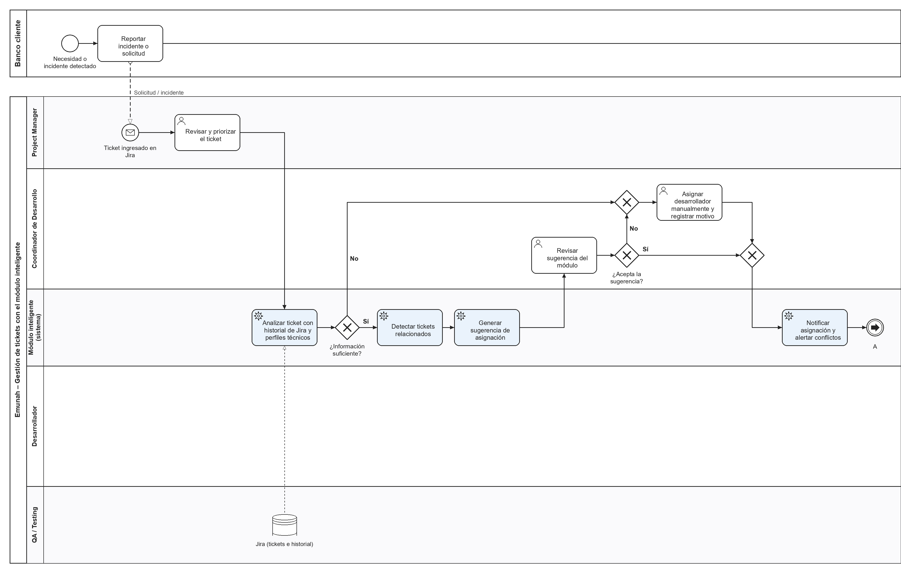
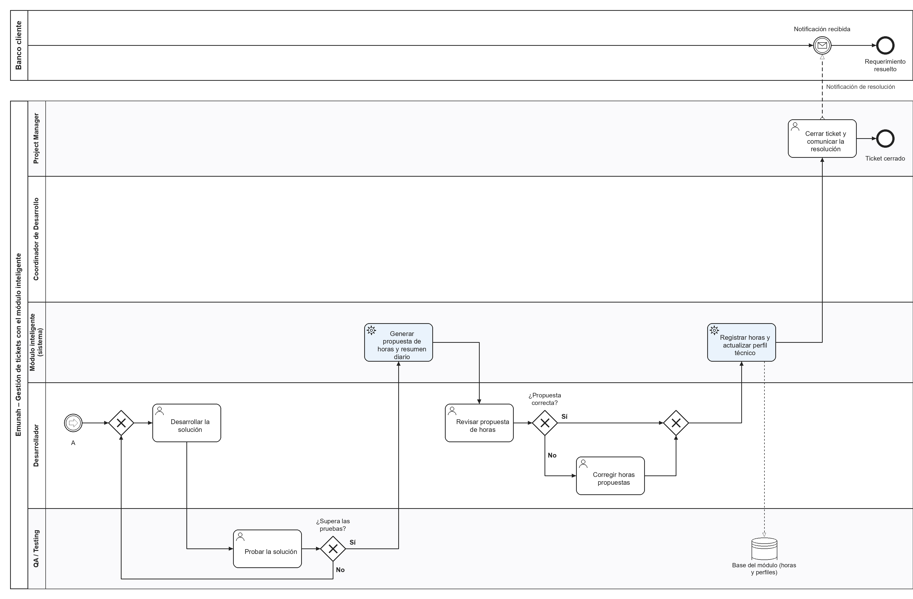

# Entrega 4 · Modelado del proceso de negocio (BPMN 2.0)

## Proceso modelado

**Gestión de un ticket de Trade 10 con el módulo inteligente**: desde que un banco reporta un incidente o una solicitud hasta que el ticket se cierra, con las horas registradas y el perfil técnico actualizado. Es el proceso que hoy se hace a mano (asignación a criterio del Coordinador, horas cargadas en Google Sheets) y que el módulo va a transformar.

- Archivo editable: [`diagramas/proceso_gestion_tickets.bpmn`](../diagramas/proceso_gestion_tickets.bpmn) (BPMN 2.0 XML; se abre en [demo.bpmn.io](https://demo.bpmn.io), Camunda Modeler o Bizagi).
- Imagen completa: [`diagramas/bpmn_proceso_completo.png`](../diagramas/bpmn_proceso_completo.png).

Por su extensión, el diagrama se presenta en dos partes unidas por el evento de enlace **A**.

### Parte 1 · Ingreso, análisis y asignación

### Parte 2 · Desarrollo, pruebas, registro de horas y cierre

## Alcance del modelo

El diagrama representa el ciclo de vida de **un ticket**. El resumen diario de la HU-03 se **genera** dentro de este flujo (tarea «Generar propuesta de horas y resumen diario»), pero su **consulta** por parte del Project Manager es un proceso diario aparte, que se dispara al comienzo de cada jornada (evento de inicio de temporizador) y no depende de un ticket en particular. Por eso no aparece como tarea en este modelo.

## Participantes

| Tipo | Elemento | Rol en el proceso |
|---|---|---|
| **Pool** externo | Banco cliente | Reporta el incidente o la solicitud y recibe la notificación de resolución. Se comunica con Emunah solo por **flujos de mensaje**. |
| **Pool** | Emunah | Contiene el proceso interno, dividido en *lanes*. |
| Lane | Project Manager | Recibe y prioriza el ticket; lo cierra y comunica la resolución. |
| Lane | Coordinador de Desarrollo | Revisa la sugerencia del módulo y toma la decisión final de asignación. |
| Lane | Módulo inteligente (sistema) | **Comportamiento automatizado**: tareas de servicio (⚙) que analizan, sugieren, notifican y registran. |
| Lane | Desarrollador | Desarrolla la solución y revisa la propuesta de horas. |
| Lane | QA / Testing | Prueba la solución antes del cierre. |
| Almacén de datos | Jira · Base del módulo | Fuente del historial de tickets y destino de las horas y los perfiles técnicos. |

## Flujo estándar (camino feliz)

1. El banco reporta el incidente → llega como **mensaje** y se crea el ticket en Jira (evento de inicio de mensaje).
2. El PM revisa y prioriza el ticket.
3. El módulo analiza el ticket con el historial de Jira y los perfiles técnicos.
4. Si hay información suficiente, detecta tickets relacionados y genera una sugerencia de asignación.
5. El Coordinador revisa la sugerencia y la acepta.
6. El módulo notifica la asignación y alerta si hay tickets relacionados en curso (evento de enlace **A**).
7. El desarrollador desarrolla la solución y QA la prueba.
8. El módulo genera la propuesta de horas y el resumen diario; el desarrollador la revisa y la confirma.
9. El módulo registra las horas y actualiza el perfil técnico.
10. El PM cierra el ticket y notifica al banco (flujo de mensaje).

## Compuertas exclusivas (excepciones)

| Compuerta | Camino de excepción | Vinculación |
|---|---|---|
| **¿Información suficiente?** | **No** → el Coordinador asigna manualmente y registra el motivo. | Meta 3 (sugerencia para ≥ 90 % de los tickets *con información suficiente*). |
| **¿Acepta la sugerencia?** | **No** → asignación manual con `motivo_rechazo`. La decisión final es humana. | Amenaza del FODA: dependencia excesiva de la IA. |
| **¿Supera las pruebas?** | **No** → vuelve al desarrollador (ciclo de retrabajo). | Indicador de tasa de rechazo en QA. |
| **¿Propuesta correcta?** | **No** → el desarrollador corrige las horas antes de confirmarlas. | Meta 1 y tasa de aceptación de propuestas de horas. |

Las compuertas sin rótulo son **compuertas de unión** que vuelven a juntar los caminos alternativos en el flujo principal.

## Antes y después

| Actividad | Proceso actual | Con el módulo |
|---|---|---|
| Asignación de tickets | A criterio del Coordinador, según su memoria del equipo. | Sugerencia basada en historial y perfil técnico; el Coordinador decide. |
| Conflictos entre tickets | Se detectan tarde, cuando los cambios se pisan. | Alerta automática al asignar. |
| Carga de horas | Manual en Google Sheets, con olvidos. | Propuesta automática que el desarrollador confirma o corrige. |
| Seguimiento del PM | Daily y Jira. | Resumen diario automático, sin reemplazar la daily. |
